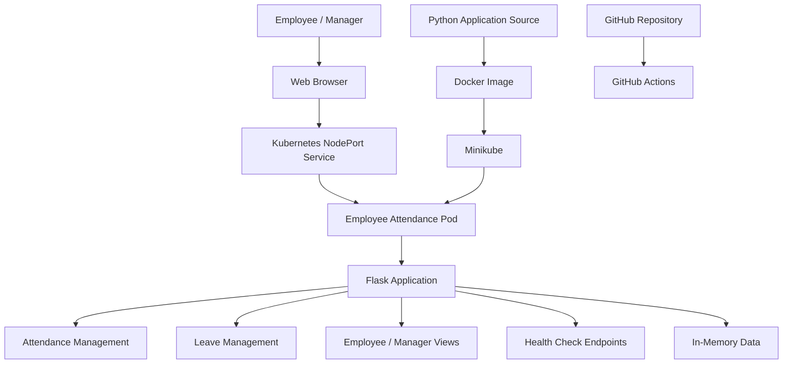

# 🛡️ Cloud-Native Employee Attendance & Leave Management System

### A Containerized, Kubernetes-Deployed Employee Attendance and Leave Management Platform

`Python` `Flask` `REST API` `Docker` `Kubernetes` `Minikube` `GitHub Actions` `Cloud-Native Architecture`

---

## 📌 Project Overview

The **Cloud-Native Employee Attendance & Leave Management System** is a web-based application designed to simplify employee attendance tracking and leave management through a centralized interface.

The project demonstrates cloud-native application development, containerization, automated deployment workflows, and orchestration using Kubernetes.

The application provides employee and manager workflows for recording attendance, submitting leave requests, and managing approvals. The current prototype uses **in-memory data storage**, allowing the application to run without configuring a database. Persistent database integration is planned for a future phase.

### 🎯 Project Objectives

- Simplify employee check-in and check-out operations.
- Digitize leave application and approval workflows.
- Provide separate employee and manager views.
- Expose application functionality through HTTP endpoints.
- Package the application as a Docker container.
- Deploy and manage the application using Kubernetes.
- Configure health checks to improve application monitoring.
- Establish a foundation for future database integration and cloud deployment.

## 🏗️ System Architecture



**Architecture flow:** The user accesses the web interface through a browser. Kubernetes exposes the containerized Flask application through a NodePort Service. The Flask application processes attendance and leave operations using in-memory data. Docker packages the application, while Minikube provides the local Kubernetes environment.

## 🚀 Key Features

### 1. Employee Attendance Management

- Employee check-in and check-out functionality.
- Attendance operations through the web interface.
- Centralized handling of attendance-related requests.
- Attendance information maintained in application memory in the current prototype.

### 2. Leave Management

- Employees can submit leave requests.
- Managers can review and process leave requests.
- A centralized workflow for employee leave management.
- Application-level handling of leave-related information.

### 3. Employee and Manager Views

- Dedicated views for employee and manager workflows.
- User-friendly web interface for accessing application features.
- Structured presentation of attendance and leave information.

### 4. REST API Integration

- HTTP endpoints for application operations.
- JSON responses for supported API endpoints.
- Separation of request handling and application functionality.

### 5. Docker Containerization

- Application packaged into a Docker image.
- Dependencies installed using `requirements.txt`.
- Consistent execution environment across supported Docker environments.
- Simplified application deployment and portability.

### 6. Kubernetes Deployment

- Application deployed through a Kubernetes Deployment.
- Kubernetes manages the application Pod.
- NodePort Service exposes the application for browser access.
- Deployment rollouts allow new container images to be introduced without manually recreating the application.

### 7. Application Health Monitoring

The Flask application provides dedicated health-check endpoints:

| Endpoint | Purpose |
|---|---|
| `/healthz` | Liveness check |
| `/readyz` | Readiness check |

These endpoints return JSON status responses and are configured for Kubernetes health monitoring.

### 8. CI/CD Foundation

The project includes a `.github` directory for repository automation. GitHub Actions can support automated validation and build workflows as configured in the repository.

## 🧰 Technology Stack

| Technology | Purpose |
|---|---|
| Python | Application programming language |
| Flask | Web application framework |
| HTML, CSS, JavaScript | Frontend interface |
| REST API | Application communication |
| Docker | Containerization |
| Kubernetes | Container orchestration |
| Minikube | Local Kubernetes cluster |
| GitHub Actions | Repository automation |
| Windows CMD | Local development and deployment commands |

## 📂 Repository Structure

```text
employee-attendance/
├── .github/
│   └── workflows/          # Repository automation workflows
├── data/                   # Application data-related files
├── services/               # Application service modules
├── static/                 # CSS, JavaScript, and static assets
├── templates/              # HTML templates
├── app.py                  # Main Flask application
├── Dockerfile              # Docker image configuration
├── requirements.txt        # Python dependencies
├── README.md               # Project documentation
└── UI_UPGRADE_NOTES.md     # UI upgrade documentation
```

*Note: The tree shows the main project structure. Exact files and subdirectories may vary as development continues.*

## 🛠️ Step-by-Step Execution Guide

### 1. Clone or Open the Project

Navigate to the project directory in Windows CMD:

```cmd
cd "C:\Users\kamalesh\Desktop\CNAD Project\employee-attendance"
```

### 2. Set Up the Python Environment

Create a virtual environment:

```cmd
python -m venv venv
```

Activate it:

```cmd
venv\Scripts\activate
```

Install the project dependencies:

```cmd
pip install -r requirements.txt
```

Start the Flask application:

```cmd
python app.py
```

Open the local application in your browser using the host and port configured by the Flask application. If it runs on the default port used by this project, open:

`http://127.0.0.1:5000`

### 3. Build the Docker Image

Open a CMD terminal in the project directory.

Build the application image:

```cmd
docker build -t employee-attendance-review2:ui-upgrade .
```

Verify that the image exists:

```cmd
docker images
```

The image contains the Flask application and its required Python dependencies.

### 4. Start Minikube

Start the local Kubernetes cluster:

```cmd
minikube start
```

Check the cluster status:

```cmd
minikube status
```

Verify that Kubernetes is accessible:

```cmd
kubectl get nodes
```

The Minikube node should report a `Ready` status.

### 5. Load the Docker Image into Minikube

Load the locally built image into the Minikube environment:

```cmd
minikube image load employee-attendance-review2:ui-upgrade
```

This makes the image available to Kubernetes without requiring it to be published to a remote container registry.

### 6. Deploy the Updated Application

The project deployment uses an existing Kubernetes Deployment named `employee-attendance`.

Update its container image:

```cmd
kubectl set image deployment/employee-attendance employee-attendance-review2=employee-attendance-review2:ui-upgrade
```

Check the rollout:

```cmd
kubectl rollout status deployment/employee-attendance
```

A successful rollout confirms that Kubernetes has completed the deployment update.

### 7. Verify the Kubernetes Pod

List the application Pods:

```cmd
kubectl get pods -l app=employee-attendance
```

Check the Service:

```cmd
kubectl get service employee-attendance
```

The application Pod should be `Running` and show `1/1` in the `READY` column.

### 8. Access the Application

Retrieve the Minikube Service URL:

```cmd
minikube service employee-attendance --url
```

Open the URL printed by the command in your browser.

Keep the terminal open if Minikube maintains a forwarding process in that window.

### 9. Test Application Health

Test the liveness endpoint:

```cmd
curl http://127.0.0.1:5000/healthz
```

Test the readiness endpoint:

```cmd
curl http://127.0.0.1:5000/readyz
```

These local URLs work when the application is exposed on the local port. If accessing the application through Minikube, replace the URL with the appropriate address and port for the active service.

Expected JSON response formats:

```json
{
  "status": "healthy"
}
```

```json
{
  "status": "ready"
}
```

## 🐳 Containerization & Kubernetes

### Docker Deployment Workflow

The application follows this containerization workflow:

1. Develop and test the Flask application.
2. Install dependencies from `requirements.txt`.
3. Build a Docker image.
4. Load the image into Minikube.
5. Update the Kubernetes Deployment.
6. Verify the rollout and Pod health.
7. Access the application through the Kubernetes Service.

### Kubernetes Resources

| Resource | Responsibility |
|---|---|
| Deployment | Manages application Pod replicas and image updates |
| Pod | Runs the containerized Flask application |
| NodePort Service | Exposes the application outside the cluster |
| Liveness probe | Checks whether the application is responding |
| Readiness probe | Checks whether the application is ready to receive requests |

## 🔄 Updating the Application

Whenever the source code or UI changes, rebuild the Docker image:

```cmd
docker build -t employee-attendance-review2:ui-upgrade .
```

Load the updated image into Minikube:

```cmd
minikube image load employee-attendance-review2:ui-upgrade
```

Update the Kubernetes Deployment:

```cmd
kubectl set image deployment/employee-attendance employee-attendance-review2=employee-attendance-review2:ui-upgrade
```

Wait for the rollout to finish:

```cmd
kubectl rollout status deployment/employee-attendance
```

**Important:** Rebuild the image after code changes before redeploying. Reusing the same image tag without rebuilding and reloading it can result in Kubernetes running an older image.

## 🔒 Reliability and Operational Considerations

- **Containerization:** Packages the application and dependencies together.
- **Orchestration:** Kubernetes manages the application's deployment lifecycle.
- **Health checks:** Liveness and readiness endpoints support health monitoring.
- **Controlled rollouts:** Kubernetes allows deployment updates to be monitored.
- **Local development:** Minikube enables Kubernetes experimentation without requiring a remote cluster.

These capabilities demonstrate core cloud-native deployment practices. Production security hardening, centralized logging, persistent storage, and external cloud deployment can be introduced in subsequent development phases.

## ⚠️ Current Limitations and Future Enhancements

The current implementation is a prototype, and the following distinctions are important:

- **Database:** Data is stored in application memory. A database has not yet been integrated, so data may be lost when the application restarts.
- **Production authentication:** Authentication and authorization should be reviewed and hardened before production use.
- **Scalability:** Kubernetes orchestration is configured, but production-scale performance and multi-replica data consistency have not been established.
- **Notifications:** Notification functionality depends on the current application implementation; external email or SMS delivery should not be assumed.
- **Cloud deployment:** The documented deployment targets a local Minikube cluster, not a production cloud environment.

### Planned Enhancements

- Integrate a persistent database for attendance and leave records.
- Improve authentication, role-based access control, and password security.
- Add comprehensive automated tests.
- Expand CI/CD validation and container security scanning.
- Introduce centralized logging and application metrics.
- Evaluate deployment to a managed Kubernetes service.
- Add reliable external notification delivery where required.

## 🎓 Academic Viva Talking Points

**Q: Why did you use Docker?**

Docker packages the application and its dependencies into a consistent container image, improving portability and simplifying deployment.

**Q: Why did you use Kubernetes?**

Kubernetes manages containerized workloads and provides deployment management, service discovery, health monitoring, and controlled application updates.

**Q: What is Minikube?**

Minikube runs a local Kubernetes cluster, allowing developers to learn and test Kubernetes deployments on their own machine.

**Q: What is the difference between liveness and readiness probes?**

A liveness probe checks whether the application is responding and may trigger a container restart when configured failure thresholds are reached. A readiness probe determines whether the application should receive traffic.

**Q: Why is the application currently running without a database?**

The current prototype uses in-memory storage to demonstrate the application workflow and cloud-native deployment without database configuration. Persistent database integration is planned for a later phase.

**Q: What happens to in-memory data when the application restarts?**

In-memory data is not durable. A process restart can reset application data, which is why persistent storage is an important future enhancement.

**Q: How do you deploy a new version?**

Build a new Docker image, load it into Minikube, update the image in the Kubernetes Deployment, and verify the rollout status.

**Q: Is the project deployed to AWS or another cloud provider?**

The documented environment is a local Minikube cluster. A production cloud deployment is a potential future enhancement rather than a completed implementation.

---

## 👨‍💻 Project Information

**Project:** Cloud-Native Employee Attendance & Leave Management System

**Domain:** Cloud-Native Application Development and DevOps

**Primary Technologies:** Python, Flask, Docker, Kubernetes, Minikube

**Deployment Environment:** Local Kubernetes cluster

**Storage Model:** In-memory prototype

**Status:** Working prototype with Docker containerization, Kubernetes deployment, health checks, and an upgraded web interface.

---

*This README describes the current prototype and its deployment workflow. Features marked as future enhancements should not be considered implemented until they are added and tested in the repository.*
